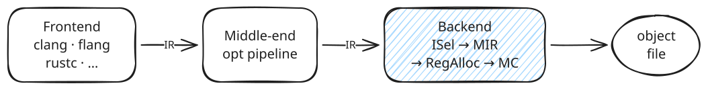
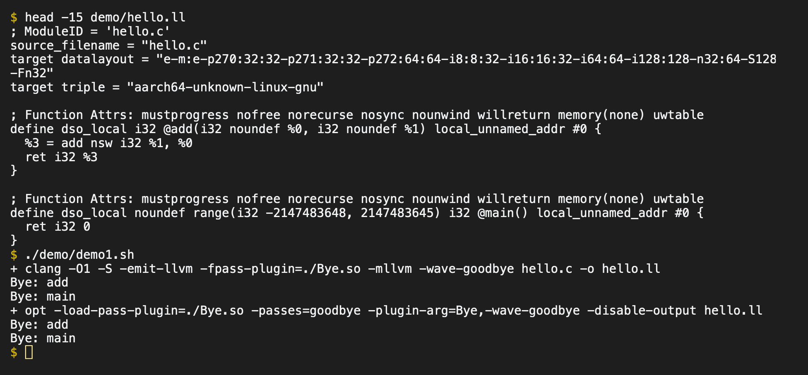
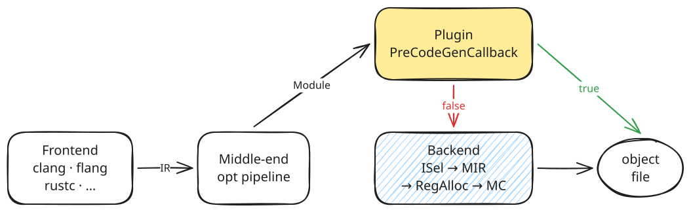
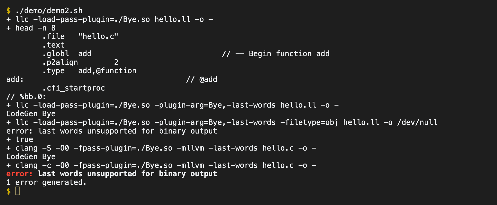
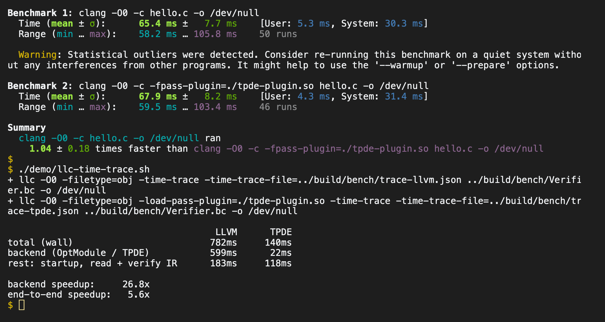

# Pluggable Backends in LLVM

**`PreCodeGenCallback` and friends** · Stefan Gränitz · Berlin LLVM meetup, 2026

> Earlier this year, LLVM's plugin interface gained the `PreCodeGenCallback` hook. It allows us to
> inject code before the backend pipeline or even replace the entire backend with a custom
> implementation. In this session we discuss opportunities and limitations of the feature and see
> how clients have been adopting it in past and ongoing releases.

This is a static version of the talk. The [slides](slides/slides.md) are a [Slidev](https://sli.dev)
deck with live terminals for the demos; see [Running the talk](#running-the-talk) to try it yourself.

1. [Introduction to pass plugins](#1-introduction-to-pass-plugins): What is an LLVM backend? • Plugin interfaces in LLVM • 🎬 Pass plugins
2. [`PreCodeGenCallback` for backends](#2-precodegencallback-for-backends): The new `PreCodeGenCallback` • Why in the pass-plugin API? • 🎬 The hook in llc • 🎬 TPDE in clang
3. [Status and outlook](#3-status-and-outlook): Who adopted it? • What's missing?

## 1. Introduction to pass plugins

### What is an LLVM backend?



**Codegen, plus:** calling conventions • debug info, EH / unwind tables • inline asm, object files,
relocations • stack maps, CFI, pointer auth

**What it cannot do:**
- add a new arch: IR depends on it, and `Triple::ArchType` is closed
- offloading: frontends split host and device code

### Why would we want a custom backend?

- **compile time:** [TPDE](https://github.com/tpde2/tpde) (10–20× faster than `-O0`)
- **other output:** llvm-cbe (C backend), llvm-spirv (Khronos SPIRV-LLVM-Translator)
- **capture the final IR:** wllvm / gllvm, `-fembed-bitcode`
- **validation:** arm-tv (Regehr, Lopes et al.) finds backend miscompilations

### Plugin interfaces in LLVM

| Interface | Loaded by |
|---|---|
| Clang frontend plugins | `clang -fplugin=` |
| Legacy-PM plugins | `opt -load` and static ctors like `RegisterTargetPassConfigCallback` |
| **New-PM pass plugins** | `clang -fpass-plugin` etc. with `llvmGetPassPluginInfo()` |
| Other unrelated ones | clang-tidy, clangd, lldb, MLIR dialect plugins, CAS plugin C API |

### The pass-plugin interface

See my [EuroLLVM 2025 talk](https://llvm.org/devmtg/2025-04/slides/technical_talk/graenitz_pass_plugins.pdf) from last year.

```cpp
struct PassPluginLibraryInfo {
  uint32_t APIVersion;         // LLVM_PLUGIN_API_VERSION: 3 on main
  const char *PluginName;
  const char *PluginVersion;
  void (*RegisterPassBuilderCallbacks)(PassBuilder &);
  bool (*PreCodeGenCallback)(Module &, TargetMachine &,
                             CodeGenFileType, raw_pwrite_stream &);  // LLVM 22
  Error (*ParseArguments)(ArrayRef<const char *> Args);              // LLVM 24
};

extern "C" PassPluginLibraryInfo llvmGetPassPluginInfo();  // looked up via dlsym
```

**Only works with the New PassManager!** It has been the default in the opt pipeline for a while, and
is still in progress for the codegen pipeline.

> The C++ ABI between plugin and host is unchecked → plugins need the exact LLVM version.

### 🎬 Demo 1 · Bye, the minimal pass plugin

[`llvm/examples/Bye`](https://github.com/llvm/llvm-project/tree/main/llvm/examples/Bye) prints Bye
for all functions 👋. One plugin, two spellings for its option:

```sh
# opt / llc (LLVM 24)
opt -load-pass-plugin=Bye.so -passes=goodbye -plugin-arg=Bye,-wave-goodbye hello.ll

# clang
clang -fpass-plugin=Bye.so -mllvm -wave-goodbye -c hello.c
```



clang runs Bye with `-emit-llvm`, because that includes the opt pipeline. It doesn't at `-O0`: Bye
registers with `registerVectorizerStartEPCallback()`, which the `-O0` pipeline doesn't run.

## 2. `PreCodeGenCallback` for backends

### `PreCodeGenCallback` landed in [#170846](https://github.com/llvm/llvm-project/pull/170846)



- **`true`** → skip the regular backend and all later plugins
- **`false`** → fall back to LLVM

It runs after the opt pipeline and before `addPassesToEmitFile`, shipped in LLVM 22, and isn't called
for `-emit-llvm`.

### Why in the pass-plugin API?

**It doesn't fit:** pass plugins *add passes* to a pipeline, this hook *replaces* the pipeline. No pass,
no `PassBuilder`, first one wins.

**Alternatives** ([#165257](https://github.com/llvm/llvm-project/pull/165257)):
- keep it in Clang (original RFC): every frontend needs its own copy
- me: `addPassesToEmitFile()` would be the right layer, but it's the wrong abstraction
- Eli Friedman: extend `PassPluginLibraryInfo` ✅

> Pragmatic: loading and distribution are already solved.

### The missing layer now exists

`llvm::runCodeGenPipeline` · Aiden Grossman, [#220305](https://github.com/llvm/llvm-project/pull/220305), Sep 2026

```cpp
Error runCodeGenPipeline(TargetMachine &TM, Module &M,
                         raw_pwrite_stream &OS, raw_pwrite_stream *DwoOS,
                         CodeGenFileType CGFT, ...);
```

- same parameters as the hook, sees the `Module`, legacy and new PM
- clang and flang use it already. Next: llc and LTO?

> Right layer + right loading mechanism, finally in one place?

### 🎬 Demo 2 · the hook in llc

Bye has a `PreCodeGenCallback` too, behind `-last-words`:

```sh
llc -load-pass-plugin=Bye.so hello.ll                                     # normal asm
llc -load-pass-plugin=Bye.so -plugin-arg=Bye,-last-words hello.ll         # CodeGen Bye
llc -load-pass-plugin=Bye.so -plugin-arg=Bye,-last-words -filetype=obj hello.ll   # error
```



### 🎬 Demo 3 · TPDE in clang

The whole plugin, about 40 lines (simplified from
[tpde-plugin.cpp](https://github.com/tpde2/tpde/blob/master/tpde-llvm/tools/tpde-plugin.cpp)):

```cpp
extern "C" PassPluginLibraryInfo llvmGetPassPluginInfo() {
  return {.APIVersion = LLVM_PLUGIN_API_VERSION, .PluginName = "TPDE-LLVM", .PluginVersion = "1",
          .PreCodeGenCallback = [](Module &mod, TargetMachine &,
                                   CodeGenFileType file_type, raw_pwrite_stream &os) {
    if (file_type != CodeGenFileType::ObjectFile) {
      mod.getContext().emitError("TPDE only support compiling to object files");
      return false;
    }
    auto compiler = tpde_llvm::LLVMCompiler::create(mod.getTargetTriple());
    std::vector<uint8_t> buf;
    if (compiler && compiler->compile_to_elf(mod, buf)) {
      os.write(reinterpret_cast<char *>(buf.data()), buf.size());
      return true;
    }
    mod.getContext().diagnose(DiagnosticInfoGeneric{"TPDE compilation failed", DS_Warning});
    return false;
  }};
}
```

TPDE ships `tpde-plugin.so` for LLVM 22+, no patch needed. It emits ELF only (x86-64 and AArch64):

```sh
clang -O0 -c -fpass-plugin=tpde-plugin.so -Werror=backend-plugin hello.c -o hello.o
clang -fuse-ld=lld hello.o -o hello && ./hello
clang -O0 -S -fpass-plugin=tpde-plugin.so hello.c   # error: no asm
```

How much faster is it? For a tiny TU in clang, there's no difference: process startup dominates.
In llc on a real workload (`llvm/lib/IR/Verifier.cpp` as bitcode, ~7900 functions), the backend
itself is more than 20× faster (26.8× in the run below), in line with TPDE's claims. End to end it's ~5×, because startup and
reading the IR stay the same:



## 3. Status and outlook

### Who adopted the `PreCodeGenCallback`?

| Client | Status |
|---|---|
| llc, clang, flang | ✅ LLVM 22+ |
| Rust | 🟡 open PR [rust#164108](https://github.com/rust-lang/rust/pull/164108): `-Zllvm-tpde=try\|only` |
| LTO, lld, distributed ThinLTO | ❌ open PR [#231516](https://github.com/llvm/llvm-project/pull/231516) |
| clang-repl | ❌ JIT path, TPDE in ORC instead |
| Julia, Zig, Swift | no evidence yet |

### What's missing?

- **LTO:** open PR [#231516](https://github.com/llvm/llvm-project/pull/231516) (regular, in-process and distributed ThinLTO)
- plugins that are **linked statically** into LLVM (`LLVM_${name}_LINK_INTO_TOOLS`) don't get the hook
- **plugin arguments** are inconsistent in clang: no `-fpass-plugin-arg`, only `-mllvm`
- **file output only**, as the API has a `raw_pwrite_stream` (no implicit JIT support)

### Related

**New Pass-Manager in Codegen:** plugin support isn't comparable to the opt pipeline yet. Plugin
passes are only nameable in `-passes=`; the target pipeline needs entry-point callbacks or something
comparable. `CodeGenPassBuilder::insertPass/disablePass` exist, but no replace/reorder.

## Running the talk

Requirements: a macOS host (Apple silicon) with [Homebrew](https://brew.sh) and
[Docker Desktop](https://www.docker.com/products/docker-desktop/) running.

```sh
./run.sh
```

On the first run, it installs `ttyd`, `tmux` and `node` with Homebrew, checks out LLVM and TPDE at
the pinned commits ([scripts/fetch-sources.sh](scripts/fetch-sources.sh)), builds both in an arm64
Linux container (TPDE emits ELF only; the LLVM build takes a while) and installs the Slidev
dependencies. Then it starts the demo terminal and the slides and opens
<http://localhost:3030> in Chrome (presenter view: `/presenter`). Later runs skip all setup steps.

The demos also run on their own, from any directory on the host:

| Script | Shows |
|---|---|
| [demo/demo1.sh](demo/demo1.sh) | Bye as a pass plugin in clang and opt |
| [demo/demo2.sh](demo/demo2.sh) | the `PreCodeGenCallback` in llc and clang |
| [demo/demo3.sh](demo/demo3.sh) | TPDE in clang: object file, no asm, fallback on unsupported IR |
| [demo/bench-clang.sh](demo/bench-clang.sh) | clang `-O0` vs TPDE (`WORKLOAD=<file.c>`) |
| [demo/bench-llc.sh](demo/bench-llc.sh) | llc `-O0` vs TPDE on `Verifier.bc` (`WORKLOAD=<file.bc>`) |
| [demo/llc-time-trace.sh](demo/llc-time-trace.sh) | where llc's time goes: backend vs everything else |
